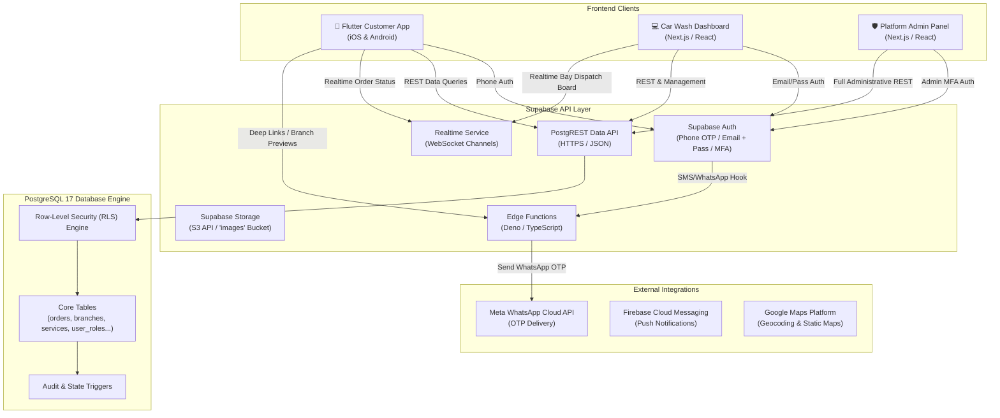

# 01 - Project Overview & Platform Architecture

## 1. Executive Summary

**CarZone** is a multi-tenant car wash reservation and branch management platform operating in Egypt. The platform connects vehicle owners with certified local car wash centers and mobile detailing providers, eliminating physical wait times through slot reservations and bay capacity scheduling.

The ecosystem operates as a single backend serving three unified clients:
1. **Customer Mobile App** (Flutter, currently live/functional): Customers locate branches, choose wash packages and add-ons, pick time slots, select their vehicles, track real-time wash statuses, and verify booking completion via QR/PIN code.
2. **Car Wash Dashboard Web Panel** (Web, to be built): Dedicated portal for car wash business owners, branch managers, and reception staff to supervise incoming bookings, manage bay throughput, schedule working hours, adjust pricing, check earnings, and respond to reviews.
3. **Platform Admin Panel** (Web, to be built): Central control center for the CarZone platform executive team to approve partner applications, govern financial commissions, execute batch payouts, oversee disputes, configure platform parameters, and inspect audit logs.

---

## 2. Platform Architecture Diagram



---

## 3. User Personas & Permissions Matrix

| Persona | Primary Needs & Responsibilities | Client Interface | Auth Method |
|---|---|---|---|
| **Customer** | • Discover car washes by area or proximity<br>• Book primary wash packages and optional add-ons<br>• Register vehicles (plate, color, make, model)<br>• Present 5-character verification code or QR at wash<br>• Rate service and file complaints | Flutter App | Phone number + OTP (WhatsApp / SMS) |
| **Car Wash Owner** | • Manage legal business profile and bank payout details<br>• Create and configure branches (working hours, bay capacity)<br>• Define services, add-ons, custom pricing, and offers<br>• Invite and manage branch managers & reception staff<br>• View net revenue, platform commissions, and payout history | Car Wash Dashboard | Business Email + Password (+ MFA) |
| **Branch Staff / Receptionist** | • View daily slot calendar and live bay schedule<br>• Check in arriving vehicles via QR scan or code search<br>• Advance booking status (Waiting ➔ In Service ➔ Completed)<br>• Mark no-shows or cancel invalid bookings<br>• Record cash / POS card collection | Car Wash Dashboard (Scoped to Branch) | Staff Email / Username + Password |
| **Platform Super Admin** | • Review and approve/reject new partner car wash applications<br>• Override branch statuses (active / suspended)<br>• Set platform commission rates (% or fixed fee per wash)<br>• Issue settlements/payouts to partner bank accounts<br>• Resolve customer complaints and moderate reviews<br>• Access full audit logs and platform health | Platform Admin Panel | Admin Email + Password + MFA |

---

## 4. Multi-Tenancy Architecture

The CarZone data layer is designed around an enterprise multi-tenant hierarchy:

```
Platform (CarZone)
 └── Business (Partner Company e.g., "Oasis Car Care Group")
      ├── Owner (User with role: carwash_owner)
      ├── Bank Account (IBAN, Bank Name for settlements)
      └── Branches (Individual physical wash stations)
           ├── Branch Settings (Auto-confirm, capacity, slot interval, cancel window)
           ├── Working Hours (Mon-Sun open/close/closed)
           ├── Services Catalog (Primary wash packages + Add-on services)
           ├── Branch Staff (Managers, Technicians, Cashiers)
           └── Orders / Bookings (Scheduled slots, items, customer car, payment state)
```

- **Tenancy Boundary**: Data isolation between car wash chains is enforced directly at the PostgreSQL layer via **Row-Level Security (RLS)**.
- A branch manager or staff member can **only query and mutate rows belonging to their assigned `branch_id`**.
- A car wash business owner can query and mutate rows for **all branches belonging to their `business_id`**.
- The platform admin has global visibility across all tenants.

---

## 5. Regional & Localization Context (Egypt)

- **Currency**: Egyptian Pound (**EGP** / **ج.م**). Stored in the database as whole integer units (piastres or integer EGP; the existing schema stores integer EGP e.g., `150` for 150 EGP).
- **Languages**: Bilingual support for Arabic (`ar`) and English (`en`).
  - Text fields visible to customers (branch names, descriptions, addresses, service titles, offer descriptions, notification messages) are stored as JSONB objects:
    ```json
    {
      "ar": "غسيل تفصيلي كامل",
      "en": "Full Detailing Wash"
    }
    ```
- **Timezone**: `Africa/Cairo` (GMT+2 / GMT+3). All timestamps in PostgreSQL are stored with time zone (`timestamptz`, UTC), and localized by the frontend client to Cairo local time.
- **Payment Habit**: Pay-at-wash is the default Egyptian behavior (customers pay either cash or via point-of-sale credit card machine at the wash reception upon service completion). Online payment (Paymob / Fawry) can be integrated as an optional prepay option.
- **Verification Code**: To guarantee service delivery before payment is captured, the system generates a 5-character alphanumeric verification code (and matching QR) upon booking confirmation, which staff verify upon car arrival.
