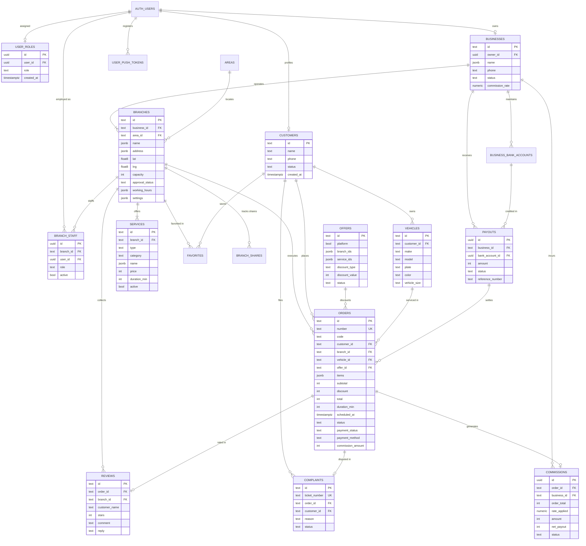
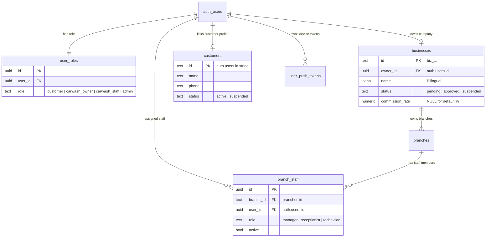
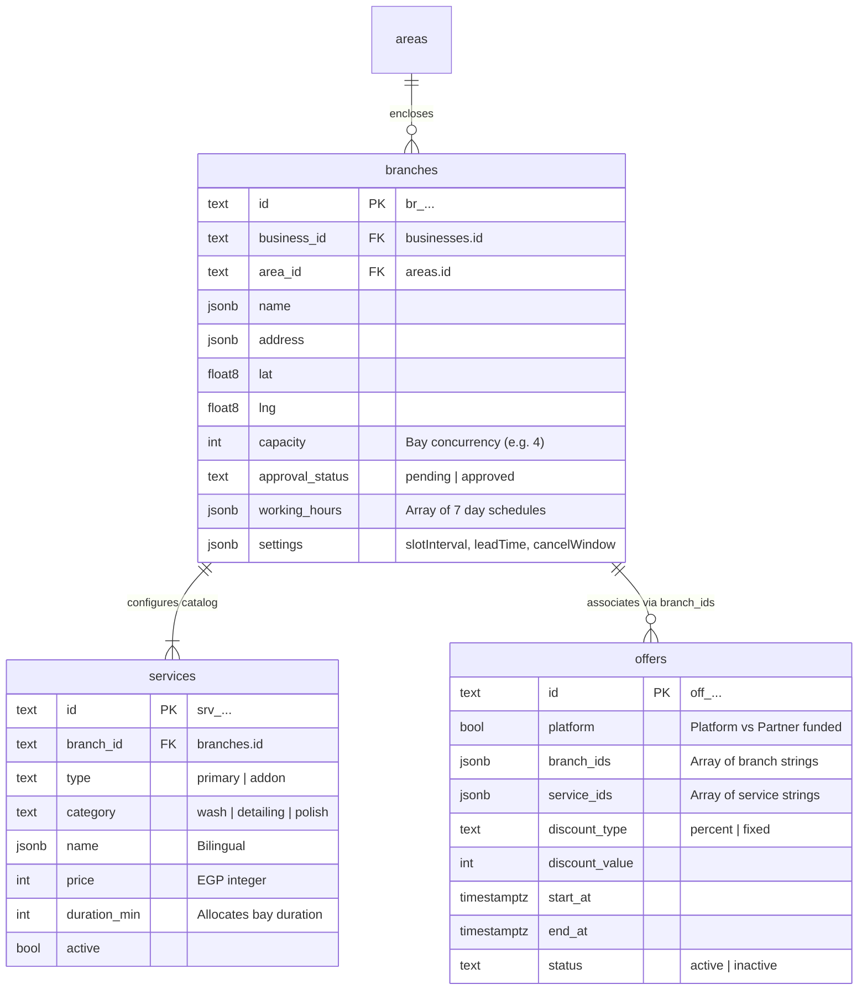
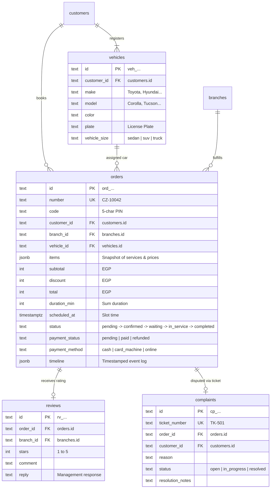
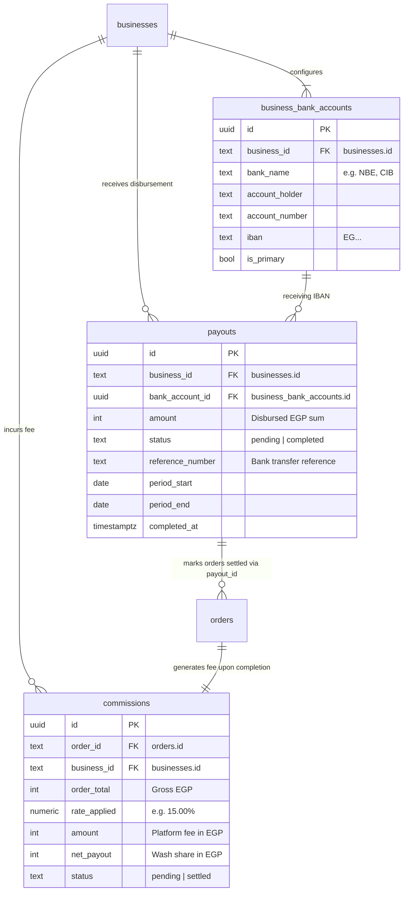

# 03 - Entity Relationship Diagrams (ERD)

This document contains visual Entity Relationship Diagrams rendered via **Mermaid**. It includes the high-level full system diagram as well as focused domain diagrams for clear readability in GitHub and markdown viewers.

---

## 1. Full Platform ERD Diagram

---

## 2. Domain Diagram: Identity, Roles & Multi-Tenancy

Shows how users, businesses, branch employees, and customer accounts relate across the tenant structure.

---

## 3. Domain Diagram: Wash Operations, Services & Schedules

Illustrates branch layout, operating capacity, hours, and catalog configuration.

---

## 4. Domain Diagram: Booking Lifecycle, Vehicles & Customer Support

Models the transaction lifecycle from vehicle registration to check-in, review, and issue dispute.

---

## 5. Domain Diagram: Financial Commissions & Settlements

Illustrates the flow of money, platform commission ledger entries, and batch bank payouts to partner car washes.

