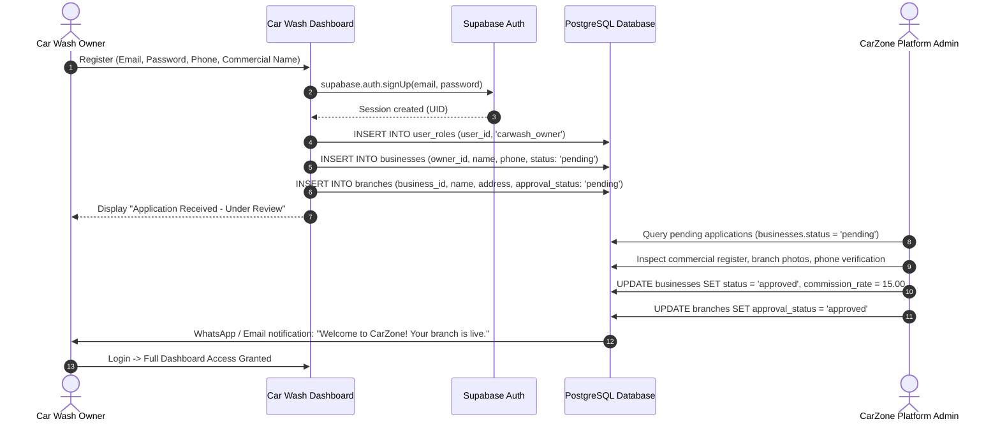

# 05 - Authentication, Authorization & Role Management

## 1. Authentication Architecture Overview

CarZone operates a multi-role authentication structure powered by **Supabase Auth** (`auth.users`), tailored to the distinct operational realities of the three client types:

```
┌──────────────────────────┐      ┌──────────────────────────┐      ┌──────────────────────────┐
│   Customer Mobile App    │      │    Car Wash Dashboard    │      │   Platform Admin Panel   │
├──────────────────────────┤      ├──────────────────────────┤      ├──────────────────────────┤
│ Phone Number + OTP       │      │ Email + Password         │      │ Email + Password + MFA   │
│ (Delivered via WhatsApp) │      │ (Invited / Registered)   │      │ (Hardware / TOTP 2FA)    │
└────────────┬─────────────┘      └────────────┬─────────────┘      └────────────┬─────────────┘
             │                                 │                                 │
             └─────────────────────────────────┼─────────────────────────────────┘
                                               ▼
                                      Supabase Auth Engine
                                         (auth.users)
                                               │
                                               ▼
                                      public.user_roles
                          (Role: customer | carwash_owner | staff | admin)
```

---

## 2. Role Resolution Strategy: Table vs JWT Claims

### Recommended Hybrid Pattern
In enterprise Supabase architectures:
1. **Single Source of Truth**: The table `public.user_roles` (`user_id`, `role`) is the authoritative source.
2. **RLS Performance**: RLS helper functions (`auth.user_role()`, `auth.user_business_id()`, `auth.user_branch_ids()`) check the database using `SECURITY DEFINER` cached lookups.
3. **Frontend Routing Optimization**: To allow web panels to redirect users without an extra network request, the user's role can also be mirrored into `app_metadata.role` via a database trigger.

> [!CAUTION]
> **CRITICAL SECURITY RULE**: Never store or check roles inside `user_metadata` or `raw_user_meta_data`. Users have client-side permission to update their own `user_metadata`, which would allow privilege escalation attacks. Always use `public.user_roles` or `app_metadata`.

### Database Role Sync Trigger
```sql
CREATE OR REPLACE FUNCTION public.sync_user_role_to_jwt()
RETURNS TRIGGER
LANGUAGE plpgsql
SECURITY DEFINER
AS $$
BEGIN
  -- Updates raw_app_meta_data in auth.users so role is embedded into the JWT token
  UPDATE auth.users
  SET raw_app_meta_data = 
    COALESCE(raw_app_meta_data, '{}'::jsonb) || jsonb_build_object('role', NEW.role)
  WHERE id = NEW.user_id;
  RETURN NEW;
END;
$$;

DROP TRIGGER IF EXISTS trg_sync_user_role ON public.user_roles;
CREATE TRIGGER trg_sync_user_role
AFTER INSERT OR UPDATE ON public.user_roles
FOR EACH ROW
EXECUTE FUNCTION public.sync_user_role_to_jwt();
```

---

## 3. How Each Panel Authenticates

### A. Customer App (Flutter)
1. User enters Egyptian mobile number (e.g., `01022437824`).
2. App converts to E.164 (`+201022437824`) and calls `supabase.auth.signInWithOtp({ phone })`.
3. Supabase Auth triggers the deployed Edge Function hook `send-sms-whatsapp`, which sends the 6-digit OTP code directly to the customer's WhatsApp (via Meta WhatsApp Cloud API) or SMS.
4. User enters OTP code; app calls `supabase.auth.verifyOTP({ phone, token, type: 'sms' })`.
5. Upon verification, Supabase issues an active JWT session.
6. The app checks if a row exists in `public.customers` matching `auth.uid()`. If not, it creates one.

### B. Car Wash Dashboard (Web)
1. Staff or Business Owner visits `/login`.
2. Signs in with business email and password:
   ```typescript
   const { data, error } = await supabase.auth.signInWithPassword({
     email: 'manager@oasiscarwash.com',
     password: 'SecurePassword123!',
   });
   ```
3. Middleware checks role:
   ```typescript
   // Next.js middleware check
   const role = session.user.app_metadata.role;
   if (role !== 'carwash_owner' && role !== 'carwash_staff') {
     await supabase.auth.signOut();
     return NextResponse.redirect('/unauthorized');
   }
   ```
4. If role is `carwash_owner`, load associated business profile from `public.businesses`.
   - If business `status === 'pending'`, show "Account pending administrative review" screen.
   - If business `status === 'approved'`, grant access to dashboard.

### C. Platform Admin Panel (Web)
1. Admin visits secure URL (e.g. `admin.carzone.eg/login`).
2. Enters administrator email and password.
3. Supabase MFA (Time-based One-Time Password / Authenticator App) verification prompt:
   ```typescript
   const { data, error } = await supabase.auth.mfa.challengeAndVerify({
     factorId: mfaFactorId,
     code: totpCode,
   });
   ```
4. Route Guard strictly validates `auth.user_role() === 'admin'`. Non-admins are immediately rejected.

---

## 4. How to Create the First Super Admin

Because RLS prevents regular users from elevating themselves to `admin`, the initial Super Admin must be provisioned either through the Supabase Dashboard SQL Editor or via direct SQL execution:

### Step 1: Create the User in Supabase Auth
Run this SQL script in the Supabase SQL Editor:

```sql
-- Replace with the intended administrator's credentials
DO $$
DECLARE
  v_admin_email TEXT := 'admin@carzone.eg';
  v_admin_pass  TEXT := 'CarZoneAdmin2026!Secure';
  v_user_id     UUID;
BEGIN
  -- Check if user already exists
  SELECT id INTO v_user_id FROM auth.users WHERE email = v_admin_email;

  IF v_user_id IS NULL THEN
    -- Generate new auth user
    v_user_id := gen_random_uuid();
    
    INSERT INTO auth.users (
      id,
      instance_id,
      email,
      encrypted_password,
      email_confirmed_at,
      raw_app_meta_data,
      raw_user_meta_data,
      created_at,
      updated_at,
      role,
      aud
    ) VALUES (
      v_user_id,
      '00000000-0000-0000-0000-000000000000',
      v_admin_email,
      crypt(v_admin_pass, gen_salt('bf')),
      now(),
      '{"provider": "email", "providers": ["email"], "role": "admin"}'::jsonb,
      '{"name": "System Administrator"}'::jsonb,
      now(),
      now(),
      'authenticated',
      'authenticated'
    );
  END IF;

  -- Assign admin role in public.user_roles
  INSERT INTO public.user_roles (user_id, role)
  VALUES (v_user_id, 'admin')
  ON CONFLICT (user_id) DO UPDATE SET role = 'admin';

  RAISE NOTICE 'Admin user % provisioned with UID %', v_admin_email, v_user_id;
END $$;
```

---

## 5. Partner Car Wash Onboarding & Approval Flow


