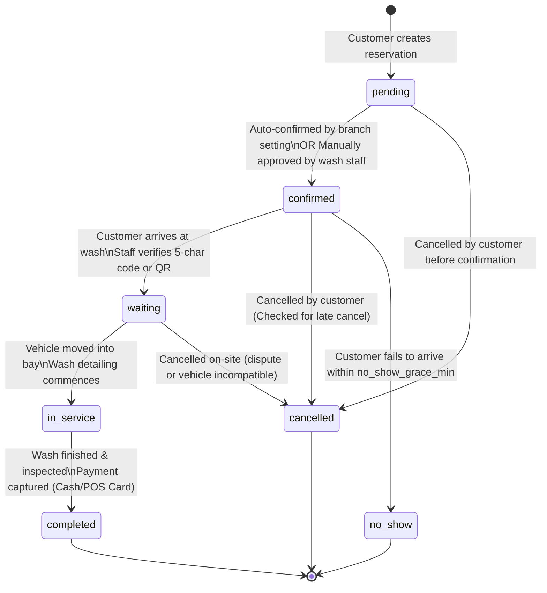
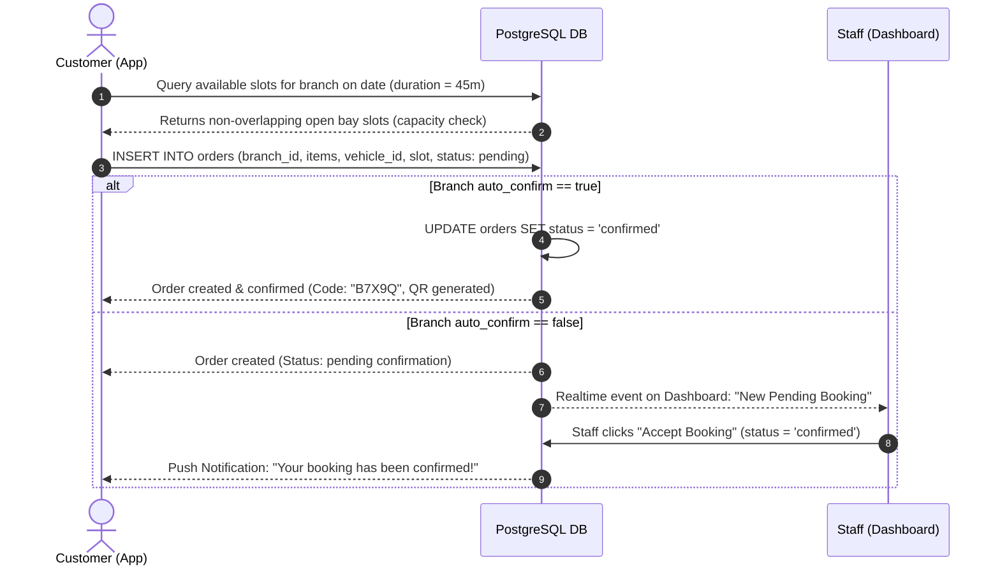
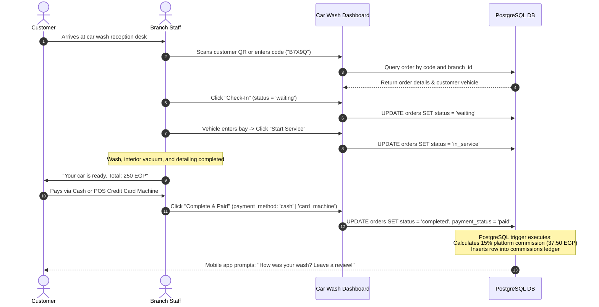
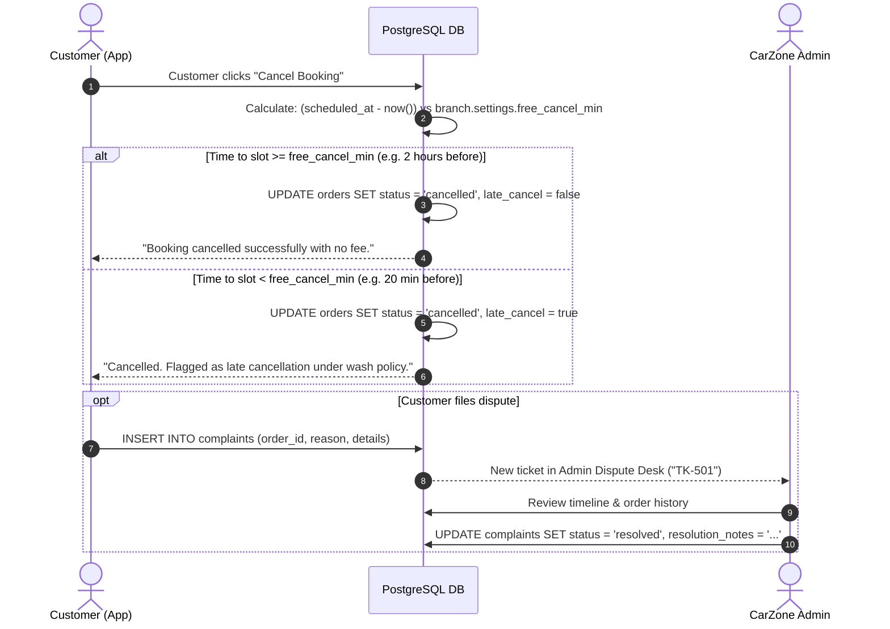
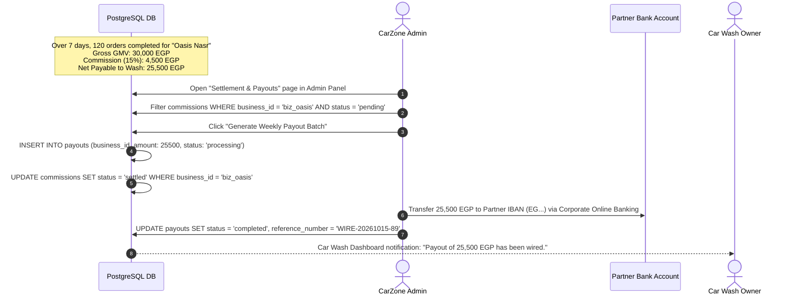

# 07 - Core Business Flows & Lifecycle State Machines

This document specifies the core operational flows of the CarZone platform using **Mermaid** state and sequence diagrams. External developers should refer to these diagrams as the authoritative logic for user workflows and status transitions.

---

## 1. Booking Status Lifecycle State Machine

The order lifecycle models a customer reservation from draft slot reservation to physical service delivery, payment capture, and feedback.

### Transition Matrix & Permitted Actors

| Transition | Permitted Role | Trigger Condition / Pre-requisite | Side Effects |
|---|---|---|---|
| `[*] -> pending` | `customer` | Customer selects active service, vehicle, and unallocated slot. | Generates 5-char code, initial timeline entry, notification to customer. |
| `pending -> confirmed` | System / `staff` | Immediate if branch `auto_confirm = true`, else manual staff click. | Timeline appended; QR code unlocked on customer screen. |
| `confirmed -> waiting` | `staff` | Physical vehicle arrival; staff verifies code or scans QR code. | Check-in timestamp recorded; bay queue counter incremented. |
| `waiting -> in_service`| `staff` | Bay becomes free; car moves into wash area. | Live countdown starts in mobile app. |
| `in_service -> completed`| `staff` | Service steps complete; payment collected at desk. | `payment_status` sets to `paid`; triggers `commissions` ledger calculation. |
| `* -> cancelled` | `customer` / `staff` | Permitted only from `pending` or `confirmed` states. | Checks `scheduled_at - now() < free_cancel_min`; marks `late_cancel` if true. |
| `confirmed -> no_show` | `staff` / System | Arrival delay exceeds `no_show_grace_min` (default: 15 min). | Frees bay slot for walk-in customers; logs customer reliability score. |

---

## 2. Complete Booking & Slot Reservation Flow

---

## 3. Pay-at-Wash & Completion Flow

---

## 4. Cancellation & Dispute Flow

---

## 5. Platform Commission & Batch Settlement Payout Flow

